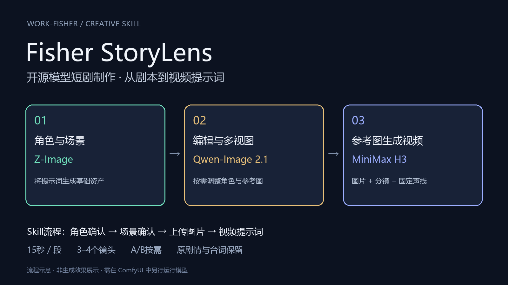
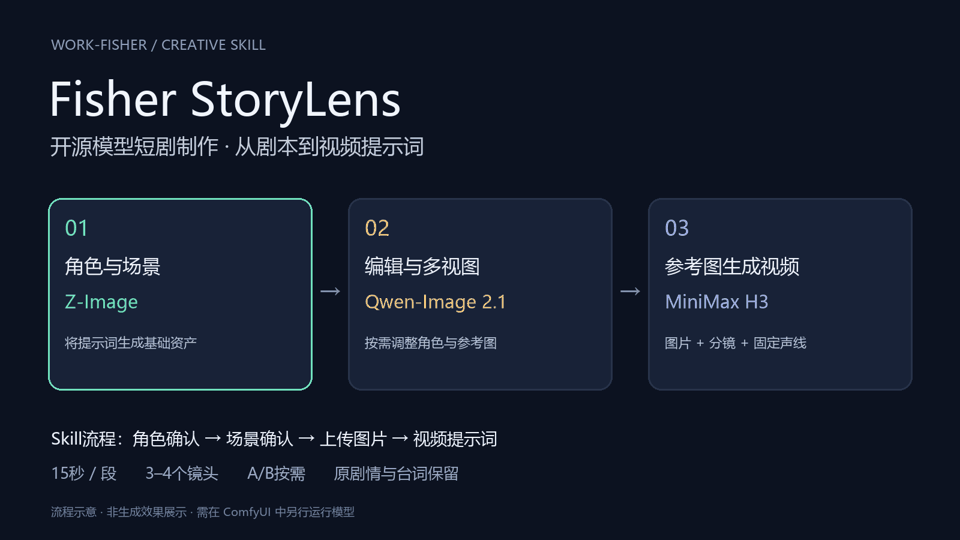

# Fisher StoryLens

### 开源模型短剧制作提示词助手 · by Work-Fisher

> 从剧本出发，先定角色、再定场景，最后依据你的图片写视频提示词。



围绕 **Z-Image → Qwen-Image 2.1 → MiniMax H3** 搭建本地短剧制作链路，面向韩剧式悬疑、复仇与人物对峙的中文创作 Skill。把角色生图、场景生图和 MiniMax 视频提示词串成一条可逐步确认的流程，保持原剧本事件与台词，并用机位表达情绪。

**15秒 / 段 · 固定3–4镜头 · 每镜1–2机位 · 中文交付**

## 怎么用



*上图为交互流程示意，不是模型生成效果或应用界面录屏。*

| 阶段 | 你提供什么 | 助手交付什么 |
|---|---|---|
| ① 定角色 | 完整剧本或需要制作的片段 | 每位角色的可复制生图提示词 |
| ② 定场景 | 确认角色，提出必要修改 | 无人场景提示词，必要道具一并给出 |
| ③ 做分镜 | 确认场景，并上传生成好的图片 | 依据真实图片编写对应视频提示词 |

每次确认只推进到下一阶段。身份对应、图片编号、连续性和分段由助手内部处理。

## 需要哪些模型和工作流

Skill负责写提示词，**ComfyUI工作流负责运行模型**；还需要一个可读取本Skill的对话助手，三类生成模型不代替这个助手。

| 模型 | 本项目中的用途 | 什么时候需要 |
|---|---|---|
| **Z-Image** | 生成角色原始造型、场景及必要道具 | 从剧本制作基础图片时 |
| **Qwen-Image 2.1** | 图像编辑、按提示制作角色多视图 | 需要修改或扩展参考图时；已有合格图片可跳过 |
| **MiniMax H3** | 用图片与分镜提示词生成带声音的视频 | 视频制作阶段 |
| SeedVR2 | 可选的图像高清放大 | 需要增强资产图片分辨率时 |

模型入口：[Z-Image](https://huggingface.co/Comfy-Org/z_image) · [Qwen-Image 2.1](https://huggingface.co/Comfy-Org/Qwen-Image-2.1) · [MiniMax H3](https://huggingface.co/Comfy-Org/MiniMax-H3)。这里采用可下载权重、本地运行的模型路线；各模型的使用许可分别以官方条款为准。

**配套流程：**角色/场景提示词 → Z-Image出图 → 按需用Qwen编辑或制作多视图 → 将确认图片交回助手 → 15秒分镜提示词 → H3参考图生视频。

- [模型文件、存放目录与可选LoRA清单](docs/models-and-workflows.md#模型文件与目录)
- [ComfyUI工作流选择、分组操作与7个插件](docs/models-and-workflows.md#工作流怎么衔接)
- [原工作流的模型选项注意事项](docs/models-and-workflows.md#导入原工作流后先核对)

本仓库提供Skill与接入指南，不附带模型权重或整合环境。当前未发布作者原始业务工作流JSON；指南给出官方工作流入口，并说明如何与作者的组合工作流衔接。

## 快速开始

将本仓库作为一个完整 Skill 文件夹交给支持 `SKILL.md` 的助手；具体加载方式以使用的客户端为准。保留 `SKILL.md` 与 `references/` 的相对位置。

也可以先在本地获取文件：

```bash
git clone https://github.com/Work-Fisher/fisher-storylens.git korean-thriller-asset-to-video
```

这条命令只下载，不自动安装，也不会调用付费生成服务。

加载 Skill 后，发送：

```text
请使用这个 Skill 处理以下剧本，先输出角色生图提示词。
角色确认后再输出场景；收到我上传的图片后，再生成视频提示词。

【在这里粘贴剧本】
```

已有确认和图片时，也可以明确指定直接处理对应片段：

```text
角色与场景已确认。以下图片依次是角色A、角色B和场景。
请根据这些图片和原剧本，输出下一段15秒的视频提示词。
保留3–4个镜头，按表达需要选择A或A/B机位，不改剧情和台词。
```

## 机位为什么这样分

**先确定镜头要表达的事件，再判断是否需要B机位。**

- A已能看清动作和回应：保持一个机位。
- A看不清关键听者反应：B承接触发后的情绪。
- A无法辨认关键道具或动作结果：B补充必要信息。
- 快闪跨地点：在编号镜头边界明确换场，按事件与对白容量分配时间。

A/B共享该镜头的时长，动作接着发生，不从头重复。全A或混合使用均可，由剧情决定。

## 输出长什么样

视频提示词固定五个字段，便于复制到后续制作流程：

```text
【参考图像锚定】
图像1是……

【分镜】
人物初始站位与空间关系：……
镜头1：主题（共1机位·约4秒）。
- [机位A·空间地标+景别运镜]：……

【Speaker 声线设定】
S1（角色名）：……

【禁止项】
文字/UI/水印/Logo/角标/可读文字/真实UI

【强制声明】
无背景音乐,仅保留环境音与人声和音效;画面禁字幕/文字/水印/Logo;禁止可读文字(指画面字幕文字,不含人声台词)
```

*这是结构摘录，不是一段完整15秒提示词。完整段落仍需3–4个镜头。*

- [完整三阶段示例：密室里的录音笔](references/worked-example.md)
- [跨场景快闪示例](references/flashback-example.md)
- [视频格式与A/B选择规范](references/video-contract.md)

## 保留剧情，也保留连续性

剧本决定事件、动作、关系、道具和逐字台词；参考图决定人物外观和空间。不能因为图片里没有群众就删掉围观剧情，也不能为了增加机位编造新事件。

同一场景承接持物、衣装、动作和空间位置；不同时间的回忆分别建立状态。声线编号跨段固定，台词可以跨切延续，口型始终归属真正说话人。

## 验证范围

已进行 Skill 结构验证、独立子agent试写和独立文本复核：

| 测试情境 | 镜头 / 机位 | 文本复核结果 |
|---|---|---|
| 连续文戏（独立测试用例） | 4镜 / 4机位，全A | 原事件与3句对白保留；格式、空间与时长预算通过复核 |
| 两场快闪（独立测试用例） | 4镜 / 5机位 | 仅证物展示增加B；关键事件与对白保留 |

这些是提示词行为测试，**尚未验证实际视频生成、口型与精确对白时长**。15秒及对白标签属于本项目交付约定，不代表所有MiniMax模型或接口均支持；实际生成前需核对所用模型能力。

## 文件结构

```text
SKILL.md                         三阶段流程入口
references/
  image-assets.md                角色、场景、道具生图规范
  video-contract.md              分镜、A/B机位与固定格式
  asset-continuity.md             图片映射与连续性
  emotion-performance-library.md  50条情绪表演取材
  worked-example.md              完整交互示例
  flashback-example.md            跨场景快闪示例
docs/assets/                     项目介绍图与动态流程示意
```

## 适用范围与来源

这是提示词创作 Skill，不是 ComfyUI 插件或一键视频生成器，也不附带模型权重、API密钥或素材图。默认适用于韩剧式文戏，人物国籍和对白语言仍以原剧本为准。

由 Work-Fisher 整理，融合原韩剧 MiniMax 提示词流程、角色与场景生图模板，以及50条情绪表演素材。情绪素材用于创作取材，不作为医学或生理学结论。

本仓库当前未附独立许可证；模型与第三方插件仍遵循各自许可。授权问题可通过仓库 Issues 联系作者。
